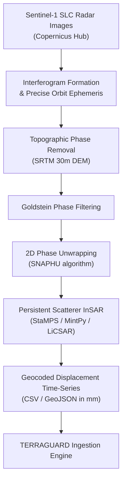

# TERRAGUARD Geospatial & External Data Integration Architecture

TERRAGUARD is engineered to ingest public earth observation datasets, satellite radar interferometry (InSAR), hydrological rainfall telemetry, and topographic digital elevation models.

---

## 1. Primary Public Satellite & Geospatial Data Sources

| Provider | Data Product / Constellation | Resolution / Frequency | Application in TERRAGUARD |
|---|---|---|---|
| **Copernicus Data Space Ecosystem** | Sentinel-1 C-Band SAR (Interferometric Wide Swath) | 5m × 20m spatial, 6–12 day repeat cycle | Ground deformation velocity and displacement time-series derived via Persistent Scatterer InSAR (PSI). |
| **NASA Earthdata / Alaska Satellite Facility (ASF)** | Sentinel-1, NISAR (future L/S band) | Global geocoded SLC products | Cloud baseline interferograms. |
| **OpenTopography / USGS** | SRTM 30m, ALOS World 3D 30m, Copernicus DEM 30m | 30m / 12.5m elevation | Topographic slope, curvature, hydrological flow routing, and 3D terrain surface rendering. |
| **CHIRPS (UC Santa Barbara / USGS)** | Climate Hazards Group InfraRed Precipitation with Station data | 0.05° spatial resolution, daily / monthly | Rainfall accumulation, pore-pressure trigger modeling. |
| **Geological Survey of India (GSI) / Bhukosh** | 1:50k Lithological & Fault Maps | Vector GIS layers | Tectonic structural lineaments, coal basin lithostratigraphy. |

---

## 2. Satellite Radar Interferometry (InSAR) Processing Workflow

> **Scientific Clarification:**  
> A raw Sentinel-1 Level-1 Single Look Complex (SLC) SAR image **does not** directly output subsidence in millimeters. Computing millimeters of ground displacement requires an interferometric processing chain:



### InSAR Formats Ingested by TERRAGUARD:
1. **LiCSAR (COMET UK)**: Pre-processed unwrapped interferograms and displacement velocities.
2. **MintPy / StaMPS**: Persistent scatterer geocoded text/CSV files containing:
   - `latitude` (WGS84 degrees)
   - `longitude` (WGS84 degrees)
   - `observation_date` (YYYY-MM-DD)
   - `displacement_mm` (cumulative line-of-sight or vertical displacement in mm)
   - `displacement_velocity_mm_year` (mean deformation rate in mm/year)

---

## 3. Configuration & Future API Ingestion

To integrate live direct API pulling from Copernicus Data Space:
1. Register on [dataspace.copernicus.eu](https://dataspace.copernicus.eu)
2. Add credentials to backend environment variables:
   ```env
   COPERNICUS_CLIENT_ID=your_client_id
   COPERNICUS_CLIENT_SECRET=your_client_secret
   ```
3. Run automated batch pipelines via Python `sentinelsat` or `copernicusmarine` wrappers.

Without credentials, the system runs with 100% functionality using direct georeferenced CSV and GeoJSON imports.
